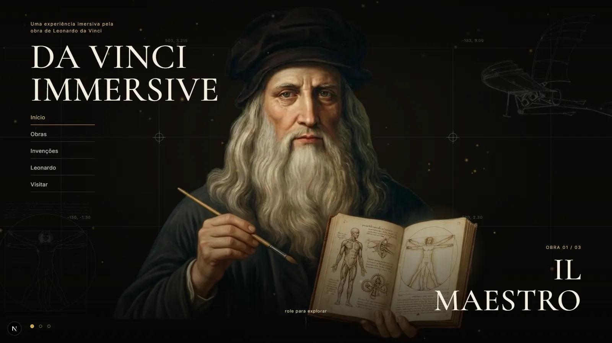
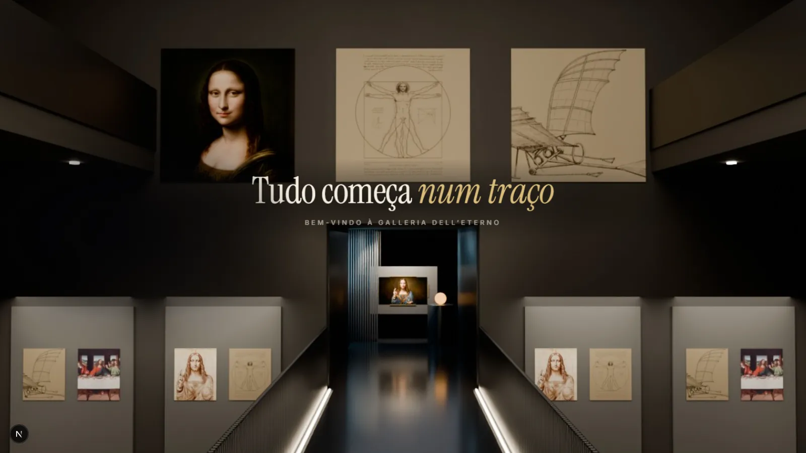
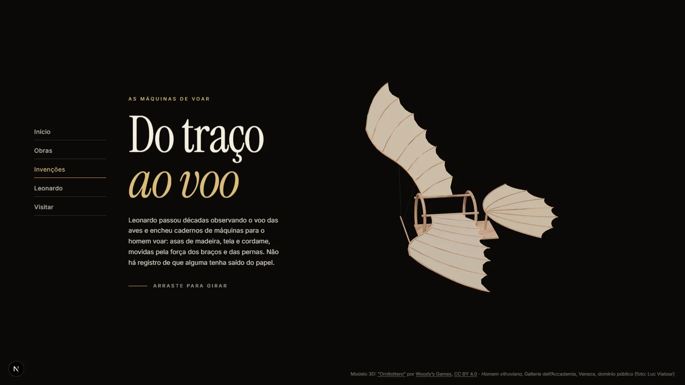
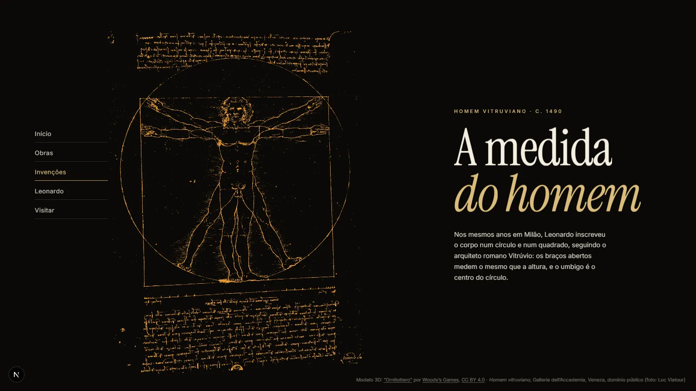
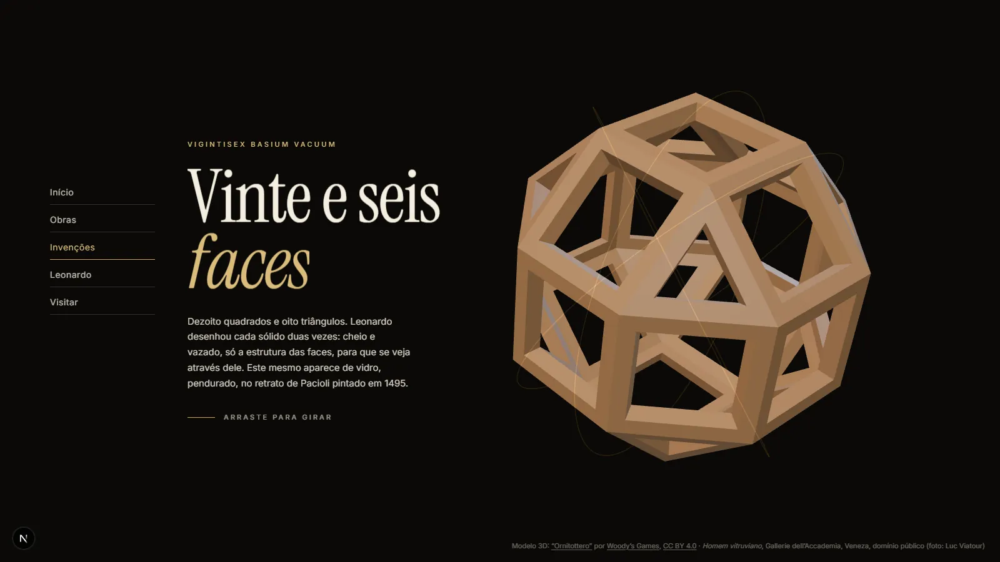
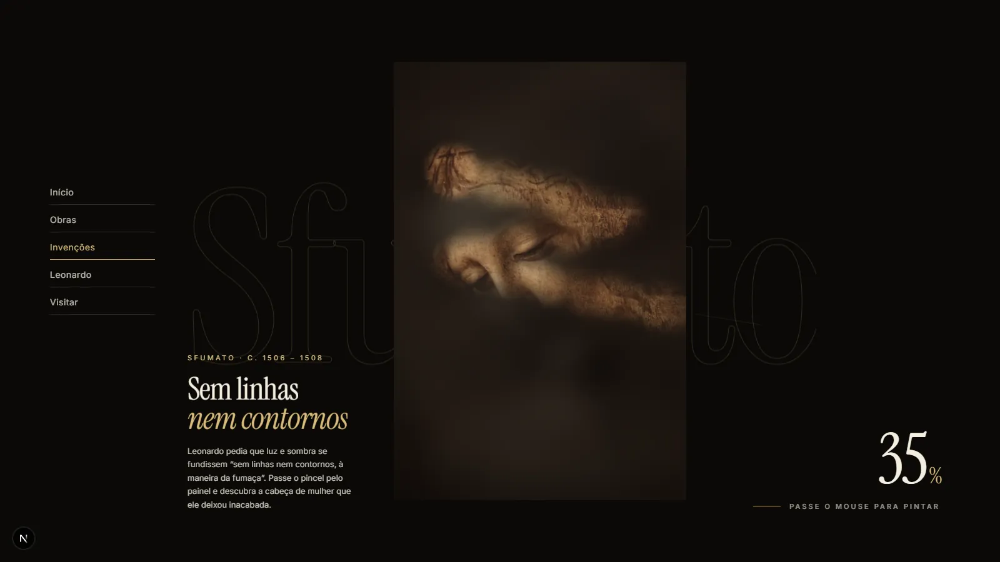
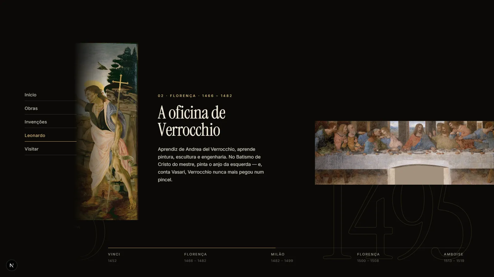

# Da Vinci Immersive

Uma experiência imersiva, guiada pelo scroll, pela obra de Leonardo da Vinci. O site é uma página só e conta uma história contínua, sem cortes: do retrato do mestre a uma galeria 3D, das máquinas de voar ao Homem Vitruviano, dos sólidos geométricos ao sfumato. O fio que costura tudo é **o traço** — a linha dourada da pena de Leonardo, que desenha, se desfaz e se refaz de uma seção para a outra.

Projeto de portfólio feito para explorar animação e WebGL no nível de sites premiados (Awwwards), dentro de um stack de produção real e com cuidado com performance e acessibilidade.



## A jornada

1. **Loading** — a porcentagem aparece em escrita espelhada, como nos cadernos de Leonardo, e vira na página ao chegar a 100.
2. **Hero** — o retrato do mestre, o *Salvator Mundi* e a *Gioconda* se alternam numa transição líquida (shader próprio de deslocamento por ruído). Cada obra guarda uma "porta": o scroll mergulha nela, e a passagem se abre como uma mancha de tinta que se espalha, já mostrando a galeria por dentro.
3. **Galeria** — um único vídeo renderizado no Blender, com câmera real, controlado frame a frame pelo scroll: o saguão, a passarela, a porta, o corredor com as obras e uma saída que afunda no escuro.
4. **O voo** — do escuro nasce o ornitóptero, primeiro como traço dourado (as arestas do próprio modelo 3D), depois como corpo. As linhas se desfazem em ~38 mil partículas que voam até a tinta do *Homem Vitruviano* verdadeiro.
5. **Os sólidos de Pacioli** — o círculo e o quadrado se soltam do desenho e atravessam a tela; o quadrado vira cubo, e o cubo se abre no rombicuboctaedro que Leonardo desenhou para o *De divina proportione*, com molduras de madeira vazadas.
6. **Sfumato** — a pena vira pincel: o visitante pinta com fumaça e revela *La Scapigliata*.
7. **Leonardo** — linha do tempo horizontal em cinco cidades, com as obras reais de cada período.
8. **Visitar e rodapé** — um ingresso de museu que inclina em 3D com o mouse e o nome "Leonardo" que começa espelhado e se desvira no fim da página.

Por todo o site, o cursor deixa um traço fino de tinta dourada que seca sozinho.

| | |
|---|---|
|  |  |
|  |  |
|  |  |

## Destaques técnicos

- **Scroll que controla vídeo** — a galeria é um MP4 codificado só com quadros-chave (`-g 1`), para o `currentTime` poder ser arrastado pelo scroll sem travar. O tempo de cada parada nas obras sai do próprio script do Blender, num JSON.
- **Uma cena WebGL, vários atos** — o ornitóptero, as partículas, o Vitruviano e os sólidos vivem no mesmo canvas (Three.js), dirigidos por um único ScrollTrigger com janelas de progresso por etapa.
  - O traço que "se desenha" é um descarte no fragment shader por ordem de revelação; o corpo usa o material PBR do modelo com o mesmo descarte injetado via `onBeforeCompile`.
  - As partículas são pareadas por posição (ângulo e raio em volta do centro de cada forma), não ao acaso — por isso a máquina vira homem sem passar por uma "bolha".
  - O rombicuboctaedro é gerado em código: os 24 vértices interpolam de um cubo achatado no papel até o sólido aberto, mantendo a mesma topologia; as molduras se encontram em meia-esquadria escalando cada face em direção ao centro.
- **Sfumato em canvas 2D** — cada pincelada são vários toques radiais macios e deslocados, acumulados numa máscara; a porcentagem revelada é medida numa amostra reduzida da máscara.
- **Transições sem corte** — cada seção começa exatamente no quadro em que a anterior terminou (o mergulho do hero termina no frame 1 da galeria; o voador sobe por cima do escuro em que a galeria termina).
- **Carregamento em etapas** — o loading espera só o que a abertura precisa; o vídeo da galeria (15 MB) e o modelo 3D carregam depois, sem disputar banda com o intro.
- **Acessibilidade** — com `prefers-reduced-motion`, as cenas pinadas viram versões estáticas ou com crossfade, e nada essencial depende de animação.

## Stack

| | |
|---|---|
| Framework | [Next.js 16](https://nextjs.org) (App Router) + TypeScript |
| Animação | [GSAP](https://gsap.com) + ScrollTrigger |
| 3D | [Three.js](https://threejs.org) — shaders GLSL próprios, GLTF com Meshopt |
| Smooth scroll | [Lenis](https://lenis.darkroom.engineering), sincronizado ao ticker do GSAP |
| Estilo | CSS Modules + Tailwind CSS v4 |
| Fontes | `next/font/google` — Instrument Serif, Cormorant Garamond e Inter |
| Galeria 3D | [Blender](https://www.blender.org) 5 (Cycles), roteirizado em Python e renderizado sem interface |

## Rodando localmente

```bash
npm install
npm run dev
```

Abre em [http://localhost:3000](http://localhost:3000).

### Renderizando a galeria (opcional)

O vídeo já está em `public/assets/gallery-flythrough.mp4`. Para gerar de novo:

```bash
# prévia rápida: poucos quadros, baixa resolução
GALLERY_MODE=preview blender --background --python blender/full_gallery.py
# render final (horas numa GPU modesta), em blender/renders/
GALLERY_MODE=full blender --background --python blender/full_gallery.py
# codifica a sequência no MP4 do site (precisa de imageio + imageio-ffmpeg)
python blender/encode_sequence.py
```

O script da cena grava também `src/components/sections/gallery-timing.json`, com os quadros de cada parada. O `encode_sequence.py` tem o caminho da pasta do projeto fixo no topo (`ROOT`) — ajuste para a sua máquina.

## Estrutura

```
src/
  app/                  # layout, fontes e a página única
  components/
    hero/               # intro em vídeo, obras em WebGL, mergulho em tinta
    nav/                # menu lateral e menu em tela cheia
    sections/           # galeria, voo + sólidos, sfumato, linha do tempo, visitar, rodapé
    ui/                 # loading, pena do cursor, texto dividido em letras
    SmoothScroll.tsx    # ponte entre Lenis e o ScrollTrigger
  hooks/                # efeito de layout isomórfico, movimento reduzido
  lib/                  # registro do GSAP, sinal de "site pronto"
blender/                # cena da galeria e codificação do vídeo
```

## Créditos

- Obras de Leonardo da Vinci em domínio público, via [Wikimedia Commons](https://commons.wikimedia.org) — *Homem Vitruviano* (foto de Luc Viatour), *La Scapigliata*, *Batismo de Cristo*, *A Última Ceia*, *Gioconda*, a paisagem do vale do Arno e o retrato em sanguínea.
- Modelo 3D [“Ornitottero”](https://sketchfab.com/3d-models/ornitottero-4ff3b11a3e9e4742a6b1bd976c59e20e) por [Woody's Games](https://sketchfab.com/woodysgames), licença [CC BY 4.0](https://creativecommons.org/licenses/by/4.0/).
- O retrato do hero e as obras exibidas na galeria 3D são imagens geradas para o projeto.

Projeto de portfólio por **Lucas Barbosa**.
